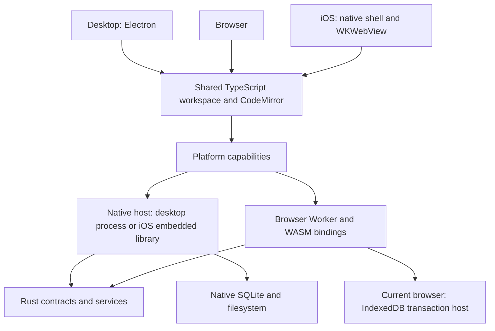

# Application architecture

Zorid is a Markdown workspace with three presentation targets and a shared Rust
data core. TypeScript renders the editor and document views; platform shells
provide windows, native navigation and operating-system integration. Rust owns
portable data semantics and native storage operations. The browser is intended
to join existing sync groups and retain local working data for fast access and
incremental catch-up. It has no user-managed native vault directory. Its current
IndexedDB/Rust-WASM path is implemented; connected service onboarding is not yet
complete.

This manual describes canonical source at `824ddd2c` plus the explicitly marked
architecture decisions accepted on 2026-10-18. Isolated feature work and historical
runtime results do not establish current feature completion.

## Start at the platform

| Platform | What presents the application | How it reaches the core |
| --- | --- | --- |
| [Desktop](platforms/desktop.md) | Electron window hosting the TypeScript workspace and CodeMirror editor | Preload/IPC → Rust host process → native core |
| [Browser](platforms/browser.md) | Shared TypeScript workspace/editor; joins existing sync groups | Rust/WASM client; current Worker/IndexedDB path differs from target |
| [iOS](platforms/ios.md) | Native UIKit/SwiftUI shell embeds the shared editor in Capacitor/WKWebView | Capacitor plugin → Swift session queue → Rust C ABI/embedded host |

Android currently retains the older Capacitor Filesystem adapter. It is not yet
an implementation of the iOS native Rust integration. The native storage design
must account for mobile lifecycle without claiming Android delivery.

The UI chooses presentation and manages editing state. A typed platform capability
selects a service; it must not quietly fall back to another storage authority after
an error. Rust plans are not commits. Storage transactions establish durability;
filesystem publication and network delivery are separate outcomes.

Follow the [product roadmap](../roadmap.md) for delivery order: storage is the
immediate milestone. This manual describes architecture rather than scheduling.

## Then follow the systems

| Module | Responsibility |
| --- | --- |
| [Editor and rendering](editor.md) | Workspace, buffers, CodeMirror, reading views and feature presentation |
| [Rust core map](rust-core.md) | Crate/system responsibilities and dependency boundaries |
| [Module interfaces](interfaces.md) | Consumer-operation coverage and storage/index/cache contract review |
| [Storage](storage.md) | Authoritative vault state, managed records and platform persistence |
| [Browser storage contract](browser-storage-contract.md) | Current IndexedDB commit, acknowledgment, scope, recovery and cache boundaries |
| [SQLite infrastructure](sqlite.md) | Current Store implementation and planned unified access layer |
| [Saving and recovery](saving-recovery.md) | Editor drafts, durable saves, physical files and planned snapshot history |
| [Documents and indexing](indexing.md) | Shared parsing, cached metadata, generation publication and optimization |
| [Query performance design](indexing-search-design.md) | Confirmed indexing/search/Bases behavior, compatibility and cache policy |
| [Search and relationships](search.md) | Literal search, link resolution and presentation queries |
| [Managed data and features](managed-data.md) | Bases, Types, Tasks, Calendar and provider boundaries |
| [Sync and security](sync.md) | Convergence, encrypted transport, relay and local-only data |
| [Bindings and CLI](bindings.md) | Desktop process, mobile C ABI, WASM and independent CLI |
| [Build and delivery](build.md) | Vite/native/WASM artifacts and meaningful validation boundaries |
| [Decisions and sequence](decisions.md) | Accepted target design and remaining work |

Read the platform path before its service modules. Use source links for precise
entry points and execution records for verification; this manual is neither a
feature-completion checklist nor a reference-app parity ledger.
