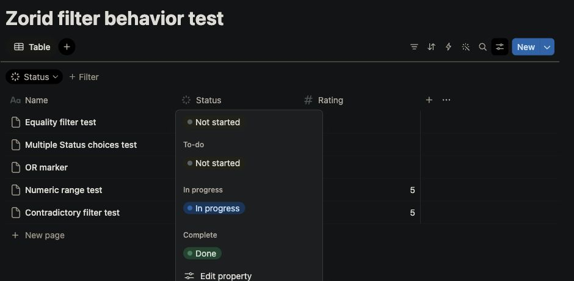
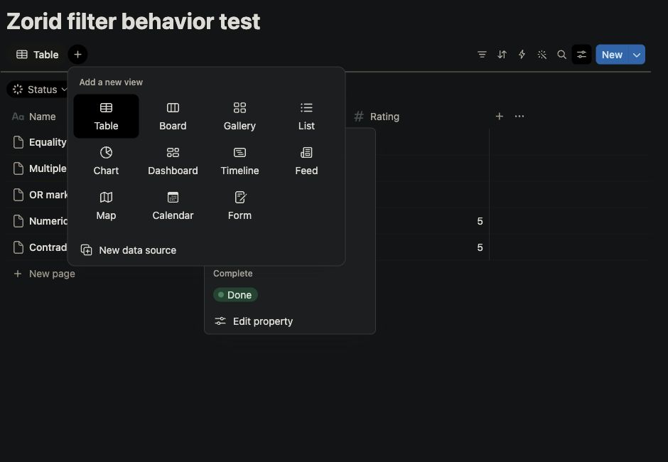

# Bases UX: Notion reference and first implementation

User direction, 2026-10-27: current Bases feels confusing and unattractive;
use Notion database interactions as the new design reference. This supersedes
older exact Obsidian UI matching targets for this scope. Ordinary notes should
not display the Properties block; confirmed database entries should retain it.

## Reference experiments

Root opened the signed-in Notion web app through CUA and explored the existing
Zorid filter behavior test database. Opened column actions, status-cell picker,
filter-chip/operator menus, current-view menu, view settings and add-view picker.
No record values or saved view definitions were intentionally changed. Double
clicking the title cell entered inline title editing; it was dismissed unchanged.

The reference keeps saved views visible and the table central, puts configuration
beside the affected object, uses quiet secondary actions and a distinct blue New
action, and displays status values as restrained colored chips. View settings
separate layout/visibility/filter/sort/group from data-source management.

Additional screenshots (column/filter/operator/view/settings menus) and actual
desktop evidence are under `/private/tmp/zorid-notion-ux-20261027`.

## Implemented first pass

- Named view tabs with manual keyboard navigation, visible add-view and direct
  current-view settings; existing overflow commands remain available.
- Explicit Create view/Cancel form: leaving a field or dismissing the menu no
  longer creates a view. New views inherit the current source using the original
  configuration version; source changes remain an explicit action.
- Left click, Enter or Space on a column opens its action menu; sorting requires
  an explicit menu choice. Resize and stale-action guards remain in place.
- Quiet icon controls, primary blue New, softer borders, neutral note links and
  36px base row height (saved density multipliers still apply). Friendly property
  labels survive schema refreshes without retaining schema or write authority.
- Properties appears only for confirmed collection members in the normal note,
  Base hover and New-item hosts. YAML remains unchanged. Existing property
  drafts/errors stay accessible through membership refreshes.

## Ownership and verification

Base `0d90cfc5`; root owns `codex/notion-bases-ux` integration worktree and the
explicitly acknowledged temporary main integrate/test/commit lane. Toolbar/table
worker owns `17ef8eb3` and `22f9c4bd`; note presentation worker owns `4b0fffa0`,
composed as `e0e3a272`. Independent scoped review found no must-fix issues in the
initial toolbar/table and Properties changes. Final Add-view review and delivery
results are recorded in the user-findings checkpoint.

Initial focused toolbar/table: 111/111 pass; Properties-focused: 94/96, with both
failures reproduced on main (obsolete global schema fixtures). Broader composed
check: 386/392 pass; all six failures reproduce identically in unchanged main's
toolbar-session suite. Explicit Create successor: 92/92 focused checks pass.
TypeScript and native frontend build pass. These are bounded checks, not a full
suite or platform parity claim.

Normal source-mode Electron observed ordinary YAML note without Properties,
managed note retaining schema controls, and new toolbar/tab controls. GPU window
capture returned blank images; a disposable software-rendered launch produced
readable screenshots and exercised direct settings, density Medium→Short,
left-click column menu and Properties menu. Existing Add-view auto-submit/source
flow exposed a confusing dismissal behavior, prompting the explicit-form fix.
Record final native results separately; these observations do not establish them.

The unchanged Rust host is reused from the prior local-collections receipt:
23 checks confirm all recorded crate trees, Cargo.lock and native host bytes.
No Rust/iOS/Tauri build is part of this pass. Packaging first hit pnpm's broken
staged-importer collection; the supported staged-project packaging invocation
retains original archive/native manifest verification hooks.

## Final delivery

Product `399591a5` is integrated into main. Final composed **162/162** focused
checks, TypeScript/native frontend build and **356-file** package verification
pass. Independent source review clears explicit creation, inherited sources,
transient source/selection rendering and presentation-only label refresh. Main
post-integration **63/63** focused checks and TypeScript pass.

Actual desktop: Create All entries produces a second selected tab over the same
collection and all three rows, without another source chooser. Properties shows
Status/Planned date/Deadline labels; search and keyboard toggle save the Status
column with values 0/9/null. Cancel/blur/Escape do not create a view. The ordinary
YAML note retains exact original bytes and hides Properties.

The packaged app was staged, verified, installed to
`/Users/ctk/Applications/Zorid.app`, then launched **without** the software
rendering flag against the disposable profile. The new view/tab and Status column
persist across restart; switching to an ordinary note hides Properties. Normal
quit exit 0; the previous installed bundle is deleted and no test app remains.
Vaults/preferences are preserved. See the adjacent
[delivery receipt](../history/bases-notion-ux-20261027.json).

Native image exports intermittently return blank frames even when tool-emitted
captures show the app. Blank PNGs are excluded from visual evidence. The Notion
browser screenshots above are readable, retained reference captures.

## Remaining design work

This first pass adapts interaction hierarchy; it does not duplicate all Notion
features or finish every database surface. Source/schema chooser forms, concise
active filter chips, richer status styling, narrow-pane/native keyboard coverage
and broad layout verification remain. The observed raw property-ID refresh bug
and redundant source picker during Add view were fixed and verified in this pass.
This remains bounded first-pass delivery, not complete Notion/database parity.
